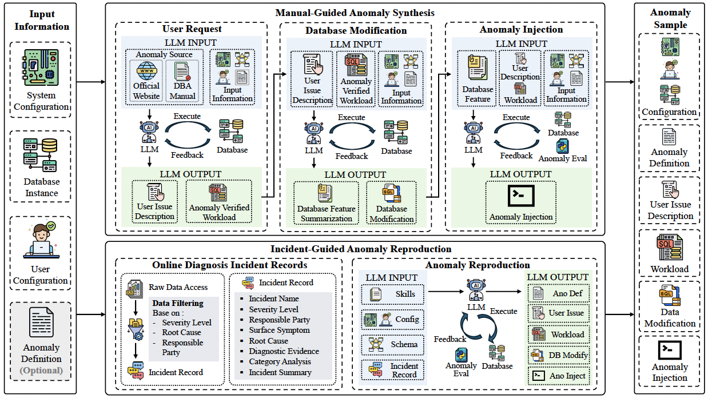

# DiagDBench: Evaluating Agentic LLMs on Interactive Database Diagnosis and Anomaly Remediation

We introduce DiagDBench, a large-scale benchmark for training and evaluating database agents on interactive diagnosis, anomaly remediation, and optional workload performance optimization across diverse, realistic anomaly scenarios.

To construct these samples at scale, we propose an LLM-based framework with two complementary pipelines: **Manual-Guided Anomaly Synthesis**, which sequentially synthesize user requests, database modifications, and anomaly-injection scripts grounded in DBA manuals and official DBMS documentation; and **Incident-Guided Anomaly Reproduction**, which reconstructs anomaly samples end to end from real-world online diagnosis incident records.



## Contents

- [Repository Layout](#repository-layout)
- [Manual-Guided Anomaly Synthesis](#manual-guided-anomaly-synthesis)
- [Incident-Guided Anomaly Reproduction](#incident-guided-anomaly-reproduction)
- [DiagDBench](#diagdbench)
- [Database Agents for Diagnosis and Remediation](#database-agents-for-diagnosis-and-remediation)
- [Evaluation](#evaluation)

## Repository Layout

The repository covers four main steps: generate anomaly samples, organize them into datasets, run database agents, and evaluate their diagnosis reports and recovery results.

```text
DiagDBench/
├── README.md
├── Overview.png                      
├── Anomaly_Def/                      # Anomaly definitions and supporting knowledge
├── Baselines/                        # Database diagnosis agents and shared tools
│   ├── ReAct/                        # Agent that repeats reasoning, actions, and observations
│   ├── Codex/                        # Codex CLI integration, database tools, and runtime checks
│   ├── Claude_Code/                  # Claude Agent SDK integration using shared Codex tools
│   ├── DB-GPT/                       # Multi-expert diagnosis agent adapted for this benchmark
│   ├── DBAIOps/                      # Knowledge-based diagnosis service and browser extension
│   ├── input_contract.py             
│   ├── preparation.py                
│   ├── container_boundary.py         
│   ├── native_runtime.py             
│   ├── recovery_artifacts.py         
│   └── script.sh                     # Starts a diagnosis agent from a configuration file
├── Evaluation/                       # Runs diagnosis and measures recovery quality
│   ├── test_baseline_eval.py         # Runs an agent and scores its diagnosis and recovery
│   ├── test_eval.py                  # Scores existing reports, recovery scripts, and workloads
│   ├── method_adapters.py            
│   ├── measurement.py                
│   ├── namespace.py                  
│   ├── recovery_reassessment.py      
│   └── offline_rescore.py
├── Configs/                          # Example configurations to copy and customize before running
├── Filter/                           # Filters samples using rules or an LLM agent; includes configurations
├── Revision/                         # Revises samples based on human review comments
├── Docker/                           # Builds and starts PostgreSQL and MySQL containers
├── Scripts/                          # Initializes/resets databases, checks anomalies, and reports database health
├── Skills/                           # Instructions for generating, reproducing, and revising anomalies
├── DiagDBench/                        # Dataset archives and sample files used in experiments
├── Data/                             # Directory for database schema files
├── Database_Instances/                # Seed data and loading files for PostgreSQL and MySQL
├── test_syn_*.py                      # LLM-based anomaly synthesis scripts
├── test_extract_*.py                  # Collects generated samples, sample indexes, and diagnosis outputs
├── test_retri*.py                     # Retrieve relevant knowledge for anomaly definitions
├── test_stat_key_info.py              # Summarizes sample counts and characteristics
├── docker_func.py                    # Manages containers, runs database commands, and limits heavy I/O tasks
├── llm_api.py                        # LLM API function call wrapper
├── utils.py                          # Common helpers, including splitting SQL into executable statements
├── prompt_template.py                # Prompt templates for the generation and diagnosis workflows
└── requirements.txt                  # Python packages required by the core workflows
```

See the [agent documentation](Baselines/README.md),
[evaluation documentation](Evaluation/README.md), and
[revision documentation](Revision/README.md) for setup and usage instructions.

### Environment Preparation

Use Linux, a compatible Python environment, Docker, Bash, tmux, and the
`nsenter`/`unshare`/`setpriv` tools required by the isolation paths. Prepare the
necessary host permissions; do not disable isolation checks to bypass a failed
preflight. From the repository root:

```bash
python -m pip install -r requirements.txt

docker build -t pg_diag \
  -f Docker/Ubuntu_PG/Dockerfile.postgresql Docker/Ubuntu_PG
docker build -t mysql_diag \
  -f Docker/Ubuntu_MySQL/Dockerfile.mysql Docker/Ubuntu_MySQL
```

The image definitions target PostgreSQL 16 and MySQL 8.4. Database seeds, schema
files and sufficient CPU/memory/disk capacity must be prepared separately.

Core requirements do **not** install every third-party baseline runtime:

- Codex needs its native CLI and the runtime checked by its preflight.
- Claude Code uses its Agent SDK and an endpoint compatible with that integration.
- DB-GPT and DBAIOps need their own configured Conda environments; DB-GPT also
  needs its native knowledge/embedding dependencies and resources.

### Configuration map

| Workflow | Configuration | Entry |
|---|---|---|
| Standalone diagnosis | `Configs/baselines/<method>/example.json` | `Baselines/script.sh` or the method's Python entry |
| Diagnosis + scoring | `Configs/evaluation/<method>/example.json` | `Evaluation/test_baseline_eval.py` |
| Score existing artifacts | `Configs/evaluation/scoring/example.json` | `Evaluation/test_eval.py` |
| Uer request / data modification / anomaly synthesis | `Configs/syn_int/`, `Configs/syn_data/`, `Configs/syn_ano/` | Corresponding root `test_syn_*.py` |
| Incident reproduction | `Configs/syn_ano_rep/example.json` | `test_syn_ano_rep.py` |
| Extract synthesized samples | `Configs/extract_key_info/example.json` | `test_extract_key_info.py` |
| Human-review revision | `Configs/revision/example.json`, `example_mysql.json` | `Revision/test_ref_anomaly.py` |
| Rule-based / agentic filtering | `Filter/Configs/example_rule.json`, `example_agentic.json` | Corresponding `Filter/test_*.py` |

## Manual-Guided Anomaly Synthesis

This pipeline instantiate abstract anomaly definitions along with error codes and timeouts from official DBMS
documentation into executable samples through three sequential stages. Each stage
uses database execution feedback to refine its outputs.

| Stage | Entry point | Configuration | Main outputs |
|---|---|---|---|
| User request | `test_syn_int.py` | `Configs/syn_int/example.json` | User issue description and verification workload |
| Database modification | `test_syn_data.py` | `Configs/syn_data/example.json` | Data-modification SQL and database feature summary |
| Anomaly injection | `test_syn_ano.py` | `Configs/syn_ano/example.json` | Injection script and anomaly-validation evidence |
| Sample extraction | `test_extract_key_info.py` | `Configs/extract_key_info/example.json` | Sample directories and `key_information.json` |

### Prepare inputs

Prepare database schemas, seed data, anomaly definitions, and a private model
configuration. `Anomaly_Def/` holds single/composite definitions and knowledge
assets. `Anomaly_Def/syn_comp_anomaly.py` constructs composite definitions;
`test_retri.py` and `test_retri_top_n.py` retrieve and enrich anomaly knowledge.

From the repository root, run retrieval first, then expand the definitions with
the retained matches. Set `ANOMALY_DIR` to your prepared input directory: each
`<id>.json` should contain one anomaly definition, either as an object or wrapped
in a single-element list. The scripts' default `Anomaly_Def/anomaly_def_formatted`
directory is not included in this checkout.

```bash
ANOMALY_DIR="/absolute/path/to/formatted_anomalies"

# PostgreSQL: retrieve error-code and timeout knowledge, then expand definitions.
python -B test_retri.py \
  --dbms_name "PostgreSQL 16.11" \
  --anomaly_dir "$ANOMALY_DIR" \
  --output_dir Output/retrieval/PG_Retrieval
python -B test_retri_top_n.py \
  --n 4 \
  --anomaly_dir "$ANOMALY_DIR" \
  --retrieve_dir Output/retrieval/PG_Retrieval \
  --output_dir Output/retrieval/anomaly_def_pg_rag

# MySQL: keep its retrieval results and expanded definitions in separate directories.
python -B test_retri.py \
  --dbms_name "MySQL 8.4" \
  --anomaly_dir "$ANOMALY_DIR" \
  --output_dir Output/retrieval/MySQL_Retrieval
python -B test_retri_top_n.py \
  --n 4 \
  --anomaly_dir "$ANOMALY_DIR" \
  --retrieve_dir Output/retrieval/MySQL_Retrieval \
  --output_dir Output/retrieval/anomaly_def_mysql_rag
```

Run the pair for your target DBMS and use definitions applicable to that system.
Retrieval reads `Anomaly_Def/knowledge_base/error_code_list.json` and
`timeout_list.json`. The expansion script matches input and retrieval filenames,
takes up to `--n` retained items (error-code matches followed by timeout matches),
and writes one expanded definition per item. Use the resulting directory as the
anomaly-definition input in the synthesis configuration.

### Run the pipeline

```bash
cp Configs/syn_int/example.json syn-int.local.json
cp Configs/syn_data/example.json syn-data.local.json
cp Configs/syn_ano/example.json syn-ano.local.json
cp Configs/extract_key_info/example.json extract-key-info.local.json

# Fill schema, anomaly-definition, database, and model settings before starting.
python -B test_syn_int.py --config syn-int.local.json

# Set syn_int_directory to the generated user-request run directory.
python -B test_syn_data.py --config syn-data.local.json

# Set syn_int_directory and syn_data_directory to the corresponding run directories.
python -B test_syn_ano.py --config syn-ano.local.json

# Set synthesized_anomaly_directory to the generated anomaly run directory.
python -B test_extract_key_info.py --config extract-key-info.local.json
```

Replace each `REPLACE_WITH_GENERATED_RUN_DIRECTORY` placeholder with the actual
output of the preceding stage. Set the extraction `output_directory` to a location
outside the repository when the samples will be used for isolated diagnosis or
evaluation. The resulting sample contract is described in [DiagDBench](#diagdbench).

## Incident-Guided Anomaly Reproduction

This pipeline reconstructs an anomaly directly from a real-world onlien diagnosis incident record,
using the database schema, system/user configuration, and reproduction guidance.
`test_syn_ano_rep.py` runs an interactive construction loop to produce the anomaly
definition, user issue description, anomaly-verified workloads, database modifications, and anomaly
injection script.

### Prepare inputs and reproduce an incident

Create a private copy of `Configs/syn_ano_rep/example.json`. Supply
`incident_record_path`, `database_schema_directory`, database/model settings, and
an output directory. Guidance is loaded from `skills_directory`, including
the incident-category and reproduction playbook files in `Skills/`.

Private incident datasets differ in their record structure and available evidence.
Adapt `test_syn_ano_rep.py` to the attributes of each source before reproduction:

- **File format and record layout:** `read_incident_record_csv` currently reads
  only the first data row of a CSV file. `build_incident_sample_list` discovers
  numeric `<id>.csv` filenames in batch mode. For multi-record CSV, JSON, or other
  exports, normalize the data to this layout or adjust these readers and the
  sample-ID mapping.
- **Field names and nested content:** update `INCIDENT_FIELD_LABELS` and
  `format_incident_record_info` to map the source's symptoms, impact,
  investigation notes, conclusions, and classification fields. Adapt the parsing
  of nested values such as `summary`, `category_by_customer`, and
  `fault_locator_msg`, including missing fields and encoding differences.
- **Incident meaning and reproduction criteria:** align source-specific category
  labels with the guidance in `Skills/`, configure the corresponding schema and
  database environment, and select a `SuccessCriterion` supported by the recorded
  evidence: performance degradation, blocking/timeouts, or execution errors.
  Extend the relevant validation logic if the source requires another criterion.

Changing the input path alone does not adapt an unfamiliar record schema.
Inspect the formatted evidence for representative records before running a batch;
retain the exclusion of tracking identifiers and raw snapshots when updating the
field mapping.

```bash
cp Configs/syn_ano_rep/example.json syn-ano-rep.local.json
# Fill the incident record, schema, database, and model settings.
python -B test_syn_ano_rep.py --config syn-ano-rep.local.json
```

Finish validation uses `Scripts/anomaly_eval_rep.py`. The declared
`SuccessCriterion` distinguishes performance degradation, blocking/timeouts, and
execution errors so that validation can match the incident's manifestation.

### Extract a reproduced sample

```bash
# Replace the sample path with an actual <id>_<database> reproduction directory.
python -B test_extract_key_info_rep.py \
  --sample-dir /absolute/path/to/reproduction_run/1_tpch_1 \
  --output-directory /absolute/path/outside/repository/reproduced_samples
```

The extractor writes the sample directory and updates `key_information.json`.
It reads the run configuration from the sample's parent directory by default;
use `--run-config` to provide another path. Reproduced samples can then follow the
same curation and evaluation workflow as manually guided samples.

## DiagDBench

DiagDBench organizes samples from both construction pipelines into a common
interface for interactive diagnosis and remediation. Each anomaly sample contains
the database environment, user issue description, anomaly-verified workloads, database modifications, and anomaly-injection script.

### Local archives versus runnable inputs

The inspected local checkout contains `DiagDBench/Eval.zip` and
`DiagDBench/Train.zip`.

Specifically, `Eval.zip` has an `Eval/` directory and
`Eval/key_information.json`, but uses packaged names such as:

- `anomaly_definition.json`
- `anomaly_verified_workload.sql`
- `user_issue_description.txt`
- `.inject_entry`, invoked through `anomaly_inject.sh`

### Filtering and human-review revision

Use `Filter/` to check sample validity and recoverability:

| Filter | Entry point | Configuration | Behavior |
|---|---|---|---|
| Rule-based | `Filter/test_filter_syn_data.py` | `Filter/Configs/example_rule.json` | Measures anomaly validity without an LLM |
| Agentic | `Filter/test_agentic_llm_filter.py` | `Filter/Configs/example_agentic.json` | Filters out recoverable samples (`failed_ids`) and retains unrecovered samples (`pass_ids`) |

Both entries accept `--config` and support `--dry-run`. Real filtering performs
database operations; the agentic filter also calls a model.

`Revision/test_ref_anomaly.py` refines samples using human review notes. It expects
wrapped `Raw_Data/<dataset>/<id>/raw_sample/` inputs and
`Human_Review/<dataset>/<three-digit-id>.txt`, rather than the flat evaluation
layout. See the [revision documentation](Revision/README.md).

```bash
cp Configs/revision/example.json revision.local.json
# Fill model/environment settings and prepare the review tree before running.
python -B Revision/test_ref_anomaly.py \
  --config revision.local.json \
  --input-root /absolute/path/to/review_input \
  --dataset PG_Syn \
  --output-root /absolute/path/to/revised_output \
  --workers 1
```

Use `Configs/revision/example_mysql.json` for MySQL. Only reviewed samples enter
the model revision loop. Successful revisions require anomaly evaluation and a
valid finish action; unreviewed or failed revisions keep the original sample
content. Keep revision output separate from the input tree.


## Database Agents for Diagnosis and Remediation

`Baselines/` implements five database agents with a shared input and output
contract. Agents use the user-observed issue, workloads, database account
information, and runtime observations to diagnose and remediate anomalies.

### Supported entry points

| Method (`workflow_type`) | Standalone entry | Diagnosis approach | Integrated scoring |
|---|---|---|---|
| `react` | `Baselines/ReAct/react.py` | Explicit reasoning/action/observation loop | Yes |
| `codex` | `Baselines/Codex/codex.py` | Native Codex CLI with controlled MCP tools | Yes |
| `claude_code` | `Baselines/Claude_Code/claude_code.py` | Native Claude Agent SDK with controlled MCP tools | Not registered in the integrated dispatcher |
| `db_gpt` | `Baselines/DB-GPT/db_gpt.py` | Native multi-expert diagnosis and recovery-artifact adapter | Yes; PostgreSQL only |
| `dbaiops` | `Baselines/DBAIOps/dbaiops.py` | Knowledge-Q&A diagnosis and recovery-artifact adapter | Yes |

DB-GPT excludes unsupported non-PostgreSQL samples.

### Run standalone diagnosis

```bash
cp Configs/baselines/react/example.json react-baseline.local.json
# Fill the local configuration first.
python -B Baselines/ReAct/react.py --config react-baseline.local.json --dry-run
bash Baselines/script.sh react-baseline.local.json
```

`Baselines/script.sh` performs configuration/port/container checks, saves a local
configuration snapshot and locks its output directory. It runs **diagnosis only**.
Use the corresponding `Configs/baselines/<method>/example.json` for another agent.
The [Evaluation](#evaluation) section covers scoring the generated artifacts.


### Shared artifacts and constraints

Baseline completion writes:

```text
diagnosis_report.md
solution_script.sh
optimized_verified_workload.sql
```

The final action's workload field is `verified_workload.sql`; the saver writes
`optimized_verified_workload.sql`. An empty optional rewrite retains the original
verification SQL as the effective artifact.


To collect existing standalone artifacts without running a model:

```bash
python -B test_extract_solution.py \
  --solution-directory Output/baselines/react \
  --output-directory Output/extracted_solutions/react
```

## Evaluation

`Evaluation/` adopt two complementary evaluation protocols: Execution-Grounded Remediation Evaluation and LLM-Judged Diagnostic Report Evaluation. It measures recovery in a reconstructed anomaly
environment and uses an LLM Judge to assess diagnosis and workload equivalence.

### Integrated diagnosis and scoring

ReAct, Codex, DB-GPT, and DBAIOps use `Evaluation/test_baseline_eval.py`. Select
the method with `baseline.workflow_type`; optional `--method` checks that this
selection matches the configuration. Integrated configs have `baseline` and
`eval` sections.

```bash
cp Configs/evaluation/react/example.json react.local.json
# Edit paths/model settings; supply OPENAI_API_KEY and JUDGE_API_KEY securely.

# No DB/model calls; requires a valid config and accessible sample inputs.
python -B Evaluation/test_baseline_eval.py \
  --config react.local.json --method react --dry-run

# Check local runtime/isolation/native prerequisites.
python -B Evaluation/test_baseline_eval.py \
  --config react.local.json --method react --preflight

# Real execution: creates containers and makes model calls.
python -B Evaluation/test_baseline_eval.py \
  --config react.local.json --method react --sample-ids 0 1
```

Use the corresponding example for another method. `--dry-run` and `--preflight`
are mutually exclusive; omit `--sample-ids` to process the configured index.
Use distinct worker port ranges, container prefixes, and output locations for
concurrent runs. Start with one worker and increase concurrency only after
checking resources and isolation prerequisites. Run DB-GPT benchmark jobs
sequentially because its native implementation uses shared intermediate files.

### Score existing artifacts

```bash
cp Configs/evaluation/scoring/example.json scoring.local.json
# Set the external sample index, solution_script_directory, output, and Judge.
python -B Evaluation/test_eval.py --config scoring.local.json --dry-run
python -B Evaluation/test_eval.py --config scoring.local.json
```

Standalone scoring uses a flat configuration and does not start a diagnosis
agent. It still performs database operations and calls the Judge. Configure
`ground_truth_diagnosis` to match the per-sample reference filename.

### Outputs and scoring semantics

Integrated outputs use `<output_root>/<id>/baseline/` and `<output_root>/<id>/eval/`;
standalone scoring uses `<output_base>/<id>/`. Evaluation produces per-sample
`score_detail.json`, Judge/measurement evidence and logs, plus the aggregate
`evaluation_result.json`.

The evaluation workflow is as follows:

1. Measure the original verified workload on a clean database.
2. Reconstruct the database, apply the anomaly and verify injection.
3. Execute the submitted recovery script and observe the configured settling time.
4. Measure the submitted effective verification workload.
5. Judge the diagnosis and ordered workload semantics using the shared evaluator.

The sample score is `0.3 * diagnosis_score + 0.7 * recovery_score`.
